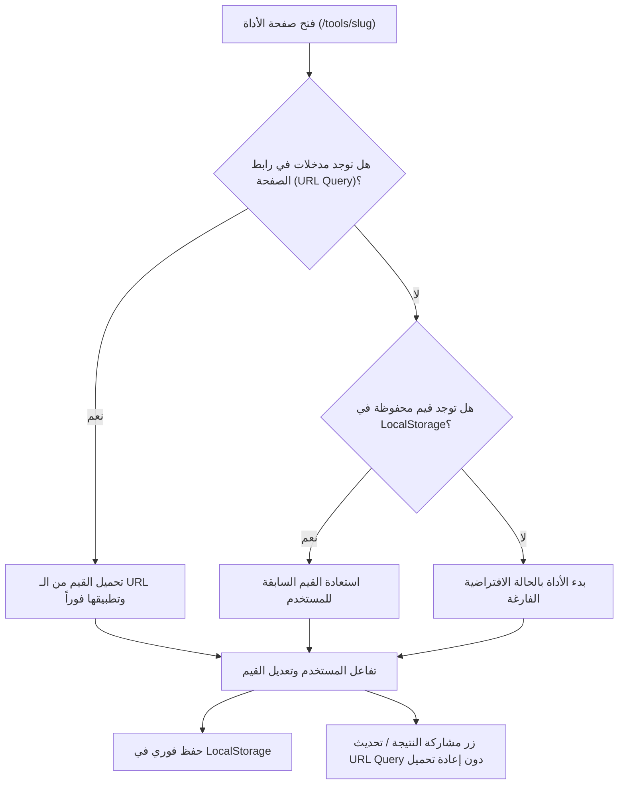

# هيكلية ومعمارية المشروع (Project Architecture)

يستعرض هذا المستند المعمارية الشاملة لمنصة **أَحَد (Ahaad)**، ومسار تدفق البيانات، وإدارة الحالة، وهيكلية المجلدات، ونمط جزر Astro.

---

## 1. الهيكلية العامة للمجلدات (Directory Structure)

```text
Ahaad/
├── public/
│   ├── favicon.ico
│   ├── favicon.svg
│   ├── fonts/                 # ملفات الخطوط المحلية WOFF2 (IBM Plex Sans Arabic)
│   ├── manifest.webmanifest   # ملف تعريف PWA
│   └── sw.js                  # Service Worker للعمل أوفلاين
├── docs/                      # توثيق المشروع للمطور ووكيل الذكاء الاصطناعي
│   ├── overview-and-tech-stack.md
│   ├── architecture.md
│   └── todo-plan.md
├── ui/                        # مخططات وتفاصيل الشاشات لواجهة المستخدم
│   ├── README.md
│   └── screens.md
├── src/
│   ├── assets/                # الأصول الثابتة الداخلية
│   ├── components/            # مكونات Astro الثابتة
│   │   ├── Header.astro       # الترويسة الرئيسية + زر الوضع الليلي
│   │   ├── Footer.astro       # التذييل البسيط وروابط المنصة
│   │   ├── ToolCard.astro     # بطاقة عرض الأداة في الصفحة الرئيسية
│   │   ├── CategoryPills.astro# شريط التصفية الأفقي للتصنيفات
│   │   ├── SearchFilter.astro # شريط البحث المباشر
│   │   ├── ToolShell.astro    # الإطار العام لصفحة الأداة
│   │   └── SeoMeta.astro      # إدارة وسوم السيو وJSON-LD
│   ├── islands/               # جزر تفاعلية مبنية بـ Preact
│   │   ├── AgeCalculator.tsx  # جزيرة حاسبة العمر (ميلادي + هجري)
│   │   ├── PercentageCalculator.tsx # جزيرة حاسبة النسب والضرائب
│   │   ├── DateDifference.tsx # جزيرة حساب الفرق بين تاريخين
│   │   └── ImageCompressor.tsx# جزيرة ضاغط ومحول الصور
│   ├── data/                  # بيانات ومخططات الأدوات والتصنيفات
│   │   ├── categories.ts      # قائمة التصنيفات المعيارية
│   │   └── tools.ts           # تعريف الأدوات، الأوصاف، والوسوم
│   ├── layouts/
│   │   └── Layout.astro       # المخطط العام، تهيئة الخطوط، والسمة
│   ├── pages/
│   │   ├── index.astro        # الصفحة الرئيسية ودليل الأدوات
│   │   ├── tools/
│   │   │   └── [slug].astro   # صفحات الأدوات الديناميكية الثابتة
│   │   └── 404.astro          # صفحة الخطأ الهادئة
│   ├── styles/
│   │   └── global.css         # أنماط Tailwind v4 و @theme
│   └── utils/                 # دوال مساعدة نقية (Pure Utilities)
│       ├── stateSync.ts       # مزامنة URL Query مع LocalStorage
│       ├── hijriDate.ts       # معالجة التقويم الهجري عبر Intl
│       └── imageCanvas.ts     # منطق ضغط الصور داخل المتصفح
├── astro.config.mjs
├── package.json
├── tsconfig.json
└── DESIGN.md                  # النظام التصميمي المعتمد
```

---

## 2. هيكلية التوجيه والروابط (Routing & URL Structure)

- **الصفحة الرئيسية:** `/`  
  تعرض محرك البحث الفوري، أزرار التصنيفات الأفقية، وشبكة بطاقات الأدوات.
- **صفحات الأدوات:** `/tools/[slug]`  
  تولد مسبقاً أثناء البناء (SSG) عبر دالة `getStaticPaths()` في الملف `src/pages/tools/[slug].astro`.
  - مثال: `/tools/age-calculator`
  - مثال: `/tools/percentage-calculator`
  - مثال: `/tools/date-difference`
  - مثال: `/tools/image-compressor`

### مزامنة الحالة وروابط المشاركة (State Sync & Shareable URLs):
تعتمد كل أداة دورة حياة دقيقة لاسترجاع ومزامنة المدخلات:


---

## 3. معمارية الجزر التفاعلية (Astro Islands Architecture)

تتبع المنصة مبدأ الحفاظ على أقل كمية ممكنة من الجافاسكريبت:
1. **صفحة الأداة الثابتة (`ToolShell.astro`):**
   - هيكل الصفحة بالكامل (العنوان، الترويسة، الوصف، الخبز التنقلي، روابط السيو) يولد كـ HTML نقي بدون أي جافاسكريبت.
2. **الجزيرة التفاعلية (`src/islands/*.tsx`):**
   - تُحمّل أداة Preact التفاعلية فقط داخل الصندوق المخصص لها باستخدام تعليمة `client:load` للأدوات الحرجة أو `client:idle` لتسريع المعالجة الأولى.
   - حجم مكتبة Preact المضغوطة لا يتعدى 3.5 كيلوبايت، مما يحافظ على سرعة فائقة.

---

## 4. نظام الألوان والسمة (Theme & Dark Mode Architecture)

### منع وميض السمة الخاطئة (Zero FOUC):
يتم وضع كود جافاسكريبت مباشر وغير متزامن في وسم `<head>` داخل `Layout.astro`، يُنفذ قبل رسم شجرة العناصر:
```javascript
(function() {
  const storedTheme = localStorage.getItem('theme');
  const userPrefersDark = window.matchMedia('(prefers-color-scheme: dark)').matches;
  if (storedTheme === 'dark' || (!storedTheme && userPrefersDark)) {
    document.documentElement.classList.add('dark');
  } else {
    document.documentElement.classList.remove('dark');
  }
})();
```

---

## 5. معمارية المعالجة المحلية بدون خادم (Local Processing Architecture)

### 1. حاسبة العمر والتواريخ (Age Calculator & Date Difference):
- استغلال واجهة المتصفح القياسية `Intl.DateTimeFormat`:
  ```typescript
  const hijriFormatter = new Intl.DateTimeFormat('ar-SA-u-ca-islamic-umalqura', {
    day: 'numeric',
    month: 'long',
    year: 'numeric'
  });
  ```
- معالجة الفروقات الزمنية بدقة عبر حساب عدد الأيام، الأشهر، والسنوات مع مراعاة السنوات الكبيسة وفروق الأشهر القمرية.

### 2. ضاغط الصور المحلي (Image Compressor):
- استخدام واجهة `FileReader` لقراءة ملف الصورة كـ `DataURL` أو `Blob`.
- تحميل الصورة داخل عنصر `Image` ثم رسمها على `HTMLCanvasElement` غير مرئي بأبعاد يتم ضبطها حسب نسبة التصغير.
- التصدير التلقائي عبر `canvas.toBlob(callback, 'image/webp', quality)` لدعم ضغط فائق وسريع لصيغة WebP أو JPEG.
- معالجة بالكامل محلياً وبشكل فوري؛ لا يتم استهلاك بيانات الإنترنت إطلاقاً.

---

## 6. السيو والبيانات المهيكلة (SEO & Schema Architecture)

لتحقيق أقصى فاعلية في محركات البحث (Google) لعمليات البحث باللغة العربية:
1. **وسوم الميتا الأساسية:**
   - عنوان دقيق وفريد لكل أداة (`title`).
   - وصف وصفي جذاب (`description`) يستهدف الكلمات المفتاحية الأكثر شيوعاً.
   - وسم الرابط المعياري (`canonical link`).
2. **البيانات المهيكلة (JSON-LD):**
   - تضمين مخطط `WebApplication` المعياري لكل أداة يحدد اسم الأداة، وصفها، أنها مجانية، وتعمل على المتصفح مباشرة.
3. **وسوم الشبكات الاجتماعية:**
   - وسوم OpenGraph و Twitter Cards لضمان ظهور بطاقات أنيقة عند مشاركة الروابط.

---

## 7. العمل دون اتصال (PWA & Offline Strategy)

- ملف `manifest.webmanifest`: يعرف أيقونات الموقع واسم المنصة باللغة العربية مع اتجاه `dir: "rtl"`.
- ملف `sw.js`: Service Worker ذكي يقوم بتخزين ملفات الـ HTML والـ CSS والخطوط المحلية `IBM Plex Sans Arabic` في ذاكرة التخزين المؤقت (Cache Storage)، لتوفير إمكانية فتح الأدوات واستخدامها في أي وقت حتى عند انقطاع الإنترنت.
